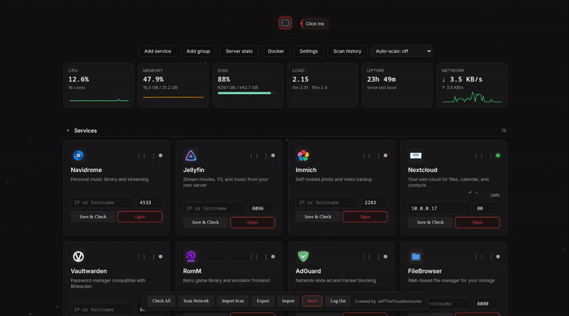
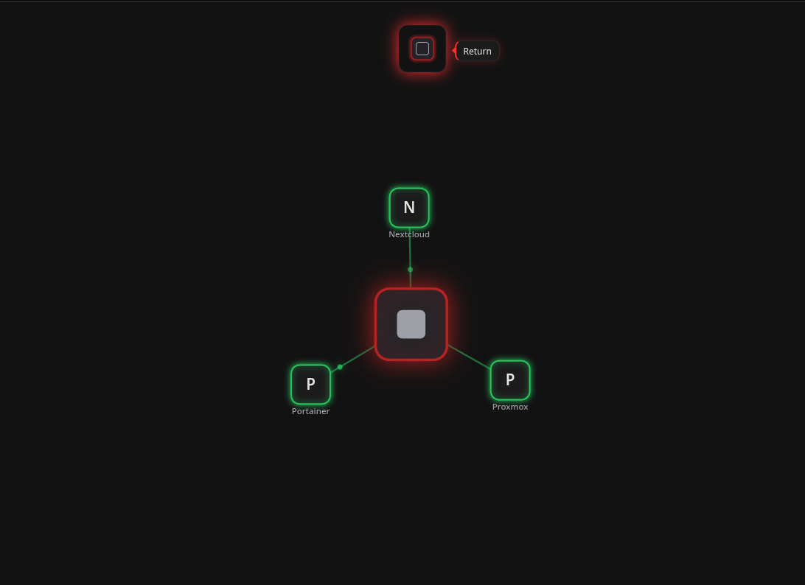
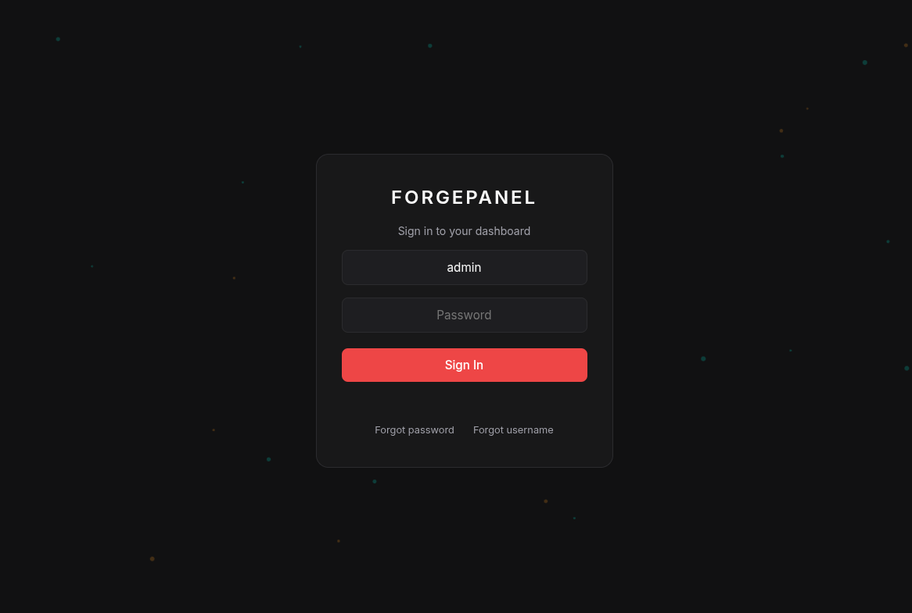
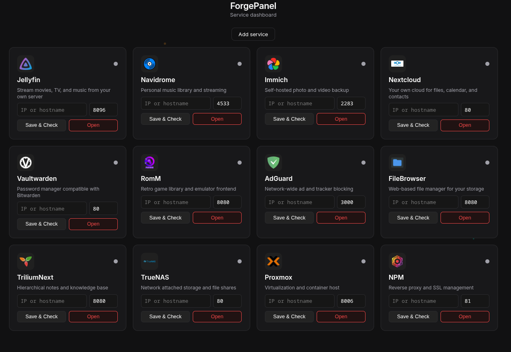
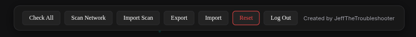
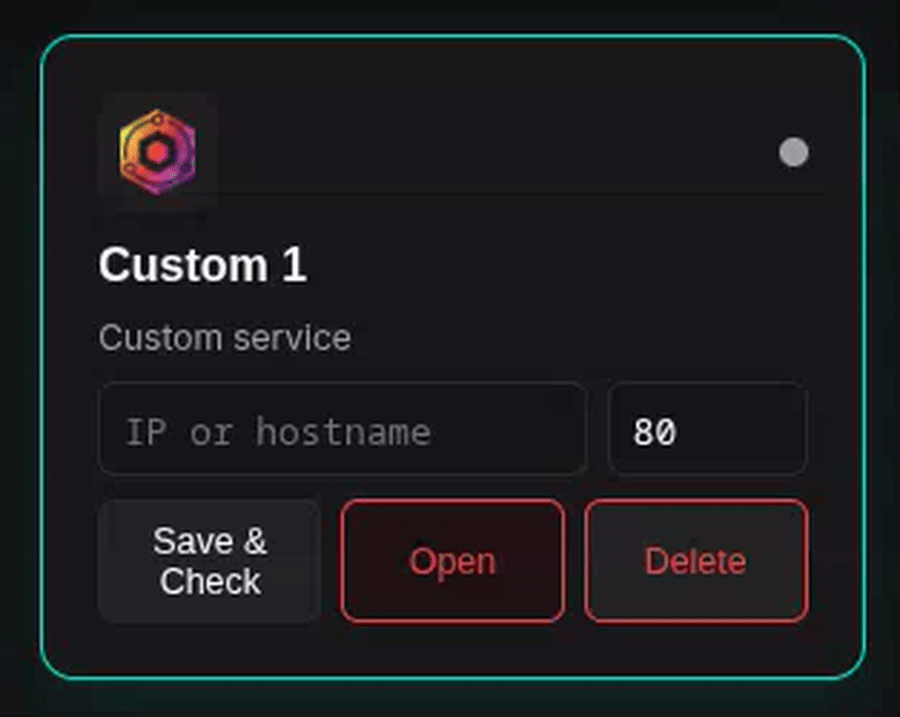
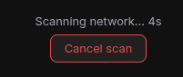
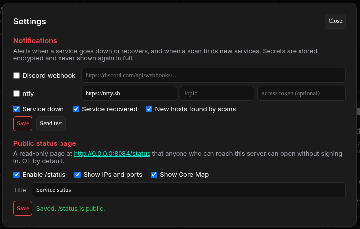
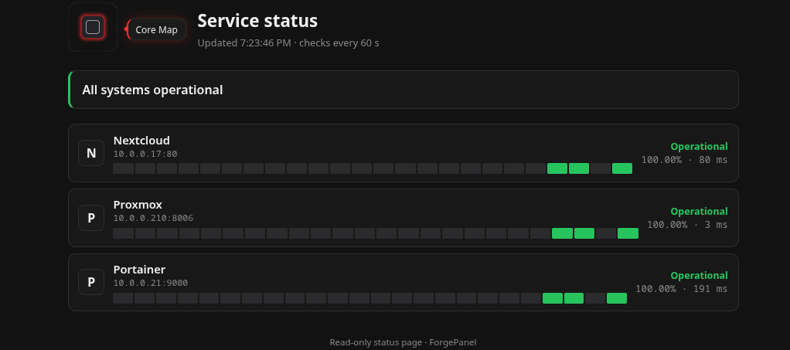

<p align="center"></p>

# ForgePanel-Dashboard

Self-hosted dashboard for accessing all your local and private services from one place. Add your own services, set names, IPs, ports, and icons, and check status at a glance.

## Core Map



Click the ForgePanel logo in the dashboard header to open **Core Map**, a full-screen animated view. The ForgePanel core sits in the center and every service (official and custom) is a tile on rings around it, joined to the core by a line:

- **Green**: connected/online. Data pulses travel along the line toward the core.
- **Red**: not connected/down. The line is dashed and flickers.
- **Yellow**: not detected (never checked, no address, or no status). The line is dashed and pulses slowly.

Hover a tile to see its name, URL and status. Click it to open the service. While Core Map is open it re-checks statuses through the server-side `/api/check` every 5 seconds. Press **Esc** or the ✕ button to close it. If your system asks for reduced motion, it draws a still map.



## Features

- Service cards with online/offline status
- Custom services (name, IP, port, icon)
- Python backend (`server.py`, standard library) with a SQLite database in `database/`
- Data encrypted at rest (AES-256-GCM, optional `cryptography` package)
- Export / Import / Reset
- Forgot password and username recovery
- Animated background
- Network scan that finds services and adds them automatically
- `GET /api/health` liveness endpoint for Docker/systemd/monitoring
- Runs in Docker as an unprivileged user (see [Docker](#docker))

## Screenshots

### Login


### Dashboard


### Settings toolbar
Check All, Export, Import, Reset and Log Out.



### Adding a custom service


[Full-quality MP4](screenshots/custom-service.mp4)

## Default Login

- **Username:** `admin`
- **Password:** `forgepanel`

Change credentials on first login.

## Structure

```
ForgePanel-Dashboard/
├── index.html
├── server.py            # static files + JSON API + SQLite
├── fp_ext.py            # check types, push, notifications, Docker, widgets, /status (stdlib)
├── Dockerfile           # container image (python:3.12-slim, non-root)
├── docker-compose.yml   # example compose file with named volumes
├── requirements.txt     # optional encryption dependency
├── database/            # forgepanel.db lives here (gitignored, never served)
├── pages/
│   ├── login.html
│   ├── dashboard.html
│   ├── status.html      # public read-only /status page
│   └── dots.html
├── js/
│   ├── auth.js
│   ├── coremap.js
│   ├── features.js      # settings, Docker import, widgets, YAML
│   └── yaml.js
├── css/
│   └── main.css
├── assets/
│   └── icons/
├── config/
│   └── forgepanel.conf
├── custom_services/
├── scan/
│   ├── scan.py
│   ├── scan.conf
│   └── results.example.json
├── tests/
│   ├── griddrag.test.js
│   └── test_server.py   # API + storage integration tests
└── .github/workflows/ci.yml
```

## Network Scan

Click **Scan Network** in the dashboard toolbar. The server runs `scan/scan.py` (Python standard library), which TCP-scans your LAN for well-known self-hosted ports (Jellyfin, Immich, Nextcloud, Proxmox, Portainer, Home Assistant, Plex, Grafana and more, set in `scan/scan.conf`) and identifies each host:port from its own responses (page title, headers/cookies, validated API/health endpoints, optional favicon hash; ports are only hints). Detected services get the program's logo and a description with the evidence; unidentified ones are shown as *Unknown service (host:port)* with a neutral icon. Results are stored (encrypted) in the database; found official services fill their tiles, everything else is added as a custom service, and IP:port duplicates are skipped.

The CLI still works and writes `scan/results.enc` (encrypted with a password you type) for **Import Scan**:

```bash
python3 scan/scan.py
```

Details in [scan/README.md](scan/README.md).

A running scan can be stopped with **Cancel scan**:



## Auto-scans, Uptime, Groups and Server Stats

- **Scheduled auto-scans** – pick *Off / Hourly / Daily / Custom* in the toolbar (or set `[schedule] interval` and `minutes` in `scan/scan.conf`; the dashboard setting wins). Scans run in a background thread. Services you don't have a tile for show up under the **Scan history** button's badge, where you can accept (adds tiles) or dismiss (hidden for good). The last 50 scans are kept as history.
- **Uptime history** – the server checks every tile (default every 60 s with a 3 s timeout; change both in **Settings → Monitoring**, `--uptime-interval` sets the default) and stores up/down plus response time in SQLite for 8 days (`--uptime-retention`). Each tile shows a sparkline; click it for 24h / 7d graphs and the uptime %.
- **Groups and reordering** – *Add group* asks for a name and lets you tick which services go in it. Grab a tile by its ⋮⋮ handle (mouse or touch): it lifts with a yellow outline, the other tiles slide aside to open a gap where you point, and it drops exactly there. Drop it on another group (its header or its tiles) and you are asked to confirm the move; *No* puts it back. The tile's ⋮ menu also has *Move to group*. Groups can be renamed, deleted, collapsed and dragged to reorder. The layout is saved in the database.
- **Scan history** – the *Scan history* button (badge = new services waiting) lists recent scans and the new services to accept or dismiss.
- **Server stats** – the *Server stats* button shows CPU, RAM, disk, uptime, load and network (read from `/proc`), refreshed every 5 s with small graphs. Linux only.

Background jobs (auto-scans and uptime checks) need the data key, which only lives in memory. After the server starts they begin once someone signs in.

## Check Types

Each tile's menu (⋮ → **Check & widget…**) picks how the service is checked. Results go into the same uptime and response-time history as before.

| Type | Up when |
|---|---|
| HTTP(S) (default) | the port answers HTTP or TLS |
| TCP | a TCP connection to IP:port opens |
| HTTP keyword | the page at `path` contains the keyword (or, with "Down when found", does not) |
| DNS | the tile's IP, used as a DNS server (port 53 by default), answers an A query for the name |
| Push | the service called its push URL within the interval |

**Push monitors.** Choosing Push creates a unique URL, for example `http://forgepanel:8084/api/push/<token>`. Call it from a cron job or script, e.g. `curl -fsS http://forgepanel:8084/api/push/<token>`. Add `?status=down` to report a failure, and `?ping=42` to record a response time (milliseconds) for the tile's sparkline and graph. The service is marked down if no push arrives within the interval (+5 s grace). The URL needs no login: the token is the only credential. It is stored hashed in SQLite, is never written to the log, and can be regenerated or revoked from the same dialog.

## Notifications (Experimental)

> **Experimental:** may not work with every setup yet.



**Settings → Notifications** sends alerts to a **Discord webhook** and/or **ntfy** (server URL, topic, optional access token):

- service down / recovered (each up↔down change seen by the background checker)
- a scan found new hosts or services

**Send test** sends a test message to every enabled channel. The webhook URL and token are stored encrypted in SQLite. They are shown masked, are never returned to the browser in full, and are never logged.

## Docker Discovery (Experimental)

> **Experimental:** may not work with every setup yet.

The **Docker** toolbar button reads `/var/run/docker.sock` (read-only GET `/containers/json`; change it with `--docker-sock PATH`) and lists running containers. Containers with labels are pre-selected:

```yaml
labels:
  forgepanel.name: "Jellyfin"
  forgepanel.url: "http://192.168.1.20:8096"
  forgepanel.icon: "jellyfin"          # ../assets/icons/jellyfin.png, or a full URL
  forgepanel.group: "Media"            # tile is put in (or creates) this group
```

Other running containers with published ports can be ticked and imported too. If the socket is missing or permission is denied, the dialog says so. To grant access, add the user running ForgePanel to the `docker` group and restart ForgePanel, or mount the socket read-only (`/var/run/docker.sock:/var/run/docker.sock:ro`).

## Tile Widgets (Experimental)

> **Experimental:** widgets for Jellyfin, Pi-hole, AdGuard and Proxmox are not fully tested yet.

Optional, per tile (**⋮ → Check & widget…**). Each widget shows one line on the tile and refreshes every 60 s (cached 30 s on the server):

| Widget | Shows | Key field |
|---|---|---|
| Jellyfin | sessions now playing | API key (Dashboard → API Keys) |
| Pi-hole | blocked queries today (v6 API, falls back to v5) | v6 password / app password, or v5 API token |
| AdGuard Home | blocked queries | username + password |
| Proxmox VE | CPU and RAM per node | API token `user@realm!tokenid=secret` (PVEAuditor is enough) |

"API URL" defaults to the tile's own address. Keys are stored encrypted in SQLite and only a masked hint goes back to the browser. Self-signed HTTPS is accepted. If a widget cannot reach its API, the tile shows a small "widget error" note and nothing else changes.

## Public Status Page

**Settings → Public status page** turns on a read-only page at `/status` (off by default). It shows every monitored service with its status, 24 h uptime, a 24-hour bar and response time, grouped like the dashboard, plus an optional read-only Core Map. It shows no secrets, URLs or push tokens. IPs and ports are hidden unless "Show IPs and ports" is ticked. When the page is off, `/api/public/status` returns 404. After a server restart it shows "unavailable" until an admin signs in once (the data key only lives in memory).



## YAML Export / Import (Experimental)

> **Experimental:** not fully tested yet; keep a .conf backup too.

**Export** asks for a format: the existing encrypted backup (`.conf`), or **YAML** (`forgepanel.yaml`). YAML is readable and editable, and contains configured services, custom tiles, check and widget settings, and groups. It leaves out secrets (widget keys, push tokens, notification settings) and uploaded (data-URL) logos. **Import** accepts `.yaml`/`.yml` and merges: matching tiles are updated, new ones are added, and the group layout is replaced. YAML is produced and parsed in the browser by a small built-in parser (`js/yaml.js`), so PyYAML is not needed.

## Core Map Extras

Hover a tile **or its line** to see the last response time. When a check goes from up to down, its line and tile pulse red for a few seconds (a steady highlight with reduced motion).

## HTTPS

HTTPS is the default (no flag needed); change it in **Settings → Security** or with `--https` / `--http` (see *Settings precedence*). The installer enables HTTPS by default (pass `--http` or set `FORGEPANEL_HTTPS=0` for plain HTTP): it installs openssl if needed and creates a self-signed RSA 2048 certificate valid 825 days (SAN = container IPs, hostname, localhost) in `<install dir>/database/certs/` (outside git, key 0600, owned by the service user, kept on reinstall). Your browser warns once about the self-signed certificate; for no warning at all, put ForgePanel behind Nginx Proxy Manager with a real certificate. On first start the server runs `openssl` to make a self-signed certificate in `database/certs/` (key is 0600, never served, never committed). Use `--cert` / `--key` to use your own certificate instead. The session cookie gets the `Secure` flag.

Your browser will warn because the certificate is self-signed. Either accept the warning once, or trust it: copy `database/certs/server.crt` to your computer and import it — Windows: *certmgr.msc → Trusted Root Certification Authorities*; macOS: Keychain Access → System → set *Always Trust*; Linux: copy to `/usr/local/share/ca-certificates/forgepanel.crt` and run `sudo update-ca-certificates`; Firefox: *Settings → Certificates → Authorities → Import*. If the server's IP or hostname changes, delete `database/certs/` and restart to make a new one.

### Behind a reverse proxy

If you terminate TLS in front of ForgePanel (Nginx Proxy Manager, Caddy, Traefik…), the server sees the proxy's IP for every request. That makes the 5-attempt login limit global, and the session cookie loses its `Secure` flag. Tell ForgePanel which proxies to trust:

```bash
python3 server.py --trusted-proxy 172.16.0.0/12 --trusted-proxy 127.0.0.1
```

Only requests whose peer is in a trusted range are allowed to set `X-Forwarded-For` / `X-Forwarded-Proto`, so never add ranges that untrusted clients can come from. Do **not** enable this if the server is directly reachable.

## Health Check

`GET /api/health` needs no login and returns no secrets. It is meant for Docker, systemd and uptime monitors:

```json
{"ok": true, "app": "forgepanel", "version": "1.1.0", "encryption": true, "uptime": 8123}
```

```bash
curl -fsS http://localhost:8084/api/health
```

## Database and Security

- `server.py` keeps everything in `database/forgepanel.db` (SQLite, file 0600, folder 0700). The server never serves `database/`, `scan/results.*`, `config/`, `.py`/`.sh`/`.conf` files or dotfiles, and has no directory listings.
- Passwords and security answers are hashed with scrypt and a random per-user salt. Sessions are random tokens in an `HttpOnly; SameSite=Strict` cookie that expires after 12 hours.
- **Inactivity auto-logout:** after 60 seconds with no mouse, keyboard, scroll or touch input (in any open dashboard tab), the dashboard signs you out and the login page shows *"You have been logged out due to inactivity."* The server enforces the same idle limit: background polling does not count as activity (it sends `X-FP-Passive: 1`), only real input sends a heartbeat. Change it in **Settings → Security** (Off, 1 min default, 5/15/30/60 min or custom minutes); the open dashboard picks up the new value immediately. `--idle-timeout SECONDS` only sets the default used until a value is saved in Settings (see *Settings precedence* below).
- **Failed sign-in lockout:** after 5 wrong passwords (configurable in **Settings → Security**, `0` = off) for the same username from the same IP, sign-in is locked for 15 minutes (configurable, 1–1440). The login page shows that it is locked and roughly when to retry. Export, backup/restore and forgot-password attempts are still limited to 5 failures per 5 minutes per IP.
- With the `cryptography` package (`python3-cryptography`) installed, dashboard settings, custom services and scan results are encrypted with AES-256-GCM. The data key is wrapped by keys derived from your password and your security answer, and is unwrapped only in server memory while you are signed in. Changing or resetting the password re-encrypts everything with a new key.
- **Without `cryptography` the data is stored unencrypted**; the server logs a warning at startup. Passwords are still hashed.
- The browser no longer stores anything except the session cookie, so the dashboard works over plain `http://<ip>`. Traffic itself is not encrypted on plain HTTP; put ForgePanel behind a reverse proxy with HTTPS (e.g. Nginx Proxy Manager) if you reach it over untrusted networks.

### Settings → Security, Monitoring, Backup

Open **Settings** in the toolbar (you must be signed in; ForgePanel has a single admin account):

| Setting | Values | Applies |
|---|---|---|
| Sign out after inactivity | Off, 1 (default), 5, 15, 30, 60 min, custom 1–1440 min | immediately |
| Protocol | HTTPS (default, self-signed cert in `database/certs/`) or HTTP | after restart (*Restart server now* button re-executes the server and shows the new URL) |
| Failed sign-in lockout | attempts 0 (off)–100, default 5; duration 1–1440 min, default 15 | immediately |
| Check every / check timeout | 10–3600 s (default 60) / 1–30 s (default 3), timeout shorter than interval | immediately |

They are saved in SQLite (`meta.sys_settings`, plain JSON, no secrets) and validated server-side.

**Settings precedence** (highest first):
1. `--force-protocol` together with `--https` or `--http` (protocol only; the dashboard selector is then locked).
2. The value saved in Settings.
3. Command-line flags as defaults: `--idle-timeout`, `--uptime-interval`, `--https` / `--http`.
4. Built-in defaults (1 min idle, HTTPS, 60 s / 3 s checks, lock after 5 failures for 15 min).

So the installer's systemd unit (which passes `--https --cert … --key …` or `--http`) keeps working and only provides the default until you change the protocol in the dashboard. If HTTPS cannot start (missing or broken certificate), the server moves the broken default pair aside (`*.bad`), regenerates the self-signed certificate, and if that also fails it serves plain HTTP with a warning in the log and in Settings, so you are never locked out. The restart button re-executes the same command line (works under systemd, OpenRC, Docker and manual runs). Custom certificate upload is not supported; use `--cert` / `--key`.

### Backup

**Settings → Backup & restore** downloads a JSON backup (after confirming your password) of everything needed to fully restore: tiles, groups, icons, settings, notification config, scan results and the account (password hash and wrapped data key, so sign in with the password that was active when the backup was made). Dashboard data and secrets stay encrypted with the account key; without `cryptography` the file says they are plain text. TLS certificates and private keys are never included, nor is uptime history. *Restore from backup…* validates the file, asks for confirmation and your current password, saves a pre-restore copy in `database/backups/` (last 5 kept), replaces the data and signs everyone out.

You can also back up the `database/` folder (stop the service first), or use **Export** in the dashboard for a password-encrypted `forgepanel.conf`. See [database/README.md](database/README.md) for backup and restore steps.

### Upgrading from the IndexedDB version

Older versions kept data in the browser. Before upgrading, open the old dashboard and click **Export**; after upgrading, sign in (default `admin` / `forgepanel`, then set new credentials) and **Import** that file with the old password. Re-running the installer switches the service from `python3 -m http.server` to `server.py` automatically.

## Automatic Install (with service)

`forgepanel-install.sh` installs ForgePanel and sets it up as a service that starts on boot.

**Supported:** Debian/Ubuntu, Fedora/RHEL, Arch, openSUSE and Alpine.

### Quick start

```bash
curl -fsSL -o forgepanel-install.sh \
  https://raw.githubusercontent.com/JeffTheTroubleshooter/ForgePanel-Dashboard/main/forgepanel-install.sh
bash forgepanel-install.sh
```

Then open **`https://<your-server-ip>:8084`**. Your browser warns once about the self-signed certificate; continue to the site.

Default login: `admin` / `forgepanel` (you must change it on first login).

### What it does

1. Installs `python3` (with sqlite3), `git`, `curl`, `python3-cryptography` and `openssl`.
2. Clones the repo to `/opt/forgepanel` (or updates it if it's already there).
3. Creates a private `database/` folder.
4. Asks for a port (default `8084`) and whether it sits behind a reverse proxy.
5. Creates a self-signed HTTPS certificate.
6. Opens the port in ufw or firewalld, if one is active.
7. Creates the `forgepanel` service (systemd, or OpenRC on Alpine).
8. Checks that the server answers before it finishes.

Running it again updates to the latest code and restarts the service. Your data is kept.

### Options

| Option | What it does |
|---|---|
| `--http` or `FORGEPANEL_HTTPS=0` | Use plain HTTP instead of HTTPS |
| Reverse proxy prompt | Adds `--trusted-proxy <CIDR>` for Nginx Proxy Manager and similar |

### Manage the service

```bash
sudo systemctl status forgepanel           # check it's running
sudo systemctl restart forgepanel          # restart
sudo systemctl disable --now forgepanel    # stop and remove from boot
```

On Alpine, use `rc-service forgepanel status|restart|stop`.

## Docker (Experimental)

> **Experimental:** the Docker image and compose setup are not fully tested yet.

A `Dockerfile` and `docker-compose.yml` are included. The image runs as an unprivileged user (`uid 10001`), keeps `database/` and `custom_services/` in volumes, and has a built-in health check against `/api/health`.

```bash
docker compose up -d --build
```

Then open `http://<your-server-ip>:8084`. To pass extra flags (for example HTTPS):

```bash
docker compose run --rm -p 8084:8084 forgepanel --https
# or edit docker-compose.yml and uncomment:  command: ["--https"]
```

Notes:

- Data lives in the `forgepanel-data` volume. Back it up with `docker run --rm -v forgepanel-data:/data -v "$PWD":/backup alpine tar czf /backup/forgepanel-database.tgz -C /data .`, or use **Export** in the dashboard.
- For **Import from Docker**, mount the socket read-only: `/var/run/docker.sock:/var/run/docker.sock:ro`.
- With a bind mount instead of a named volume, make it writable by uid 10001: `sudo chown -R 10001:10001 ./database`.
- To serve HTTPS with your own certificate, mount it and pass `--https --cert /certs/server.crt --key /certs/server.key`.

## Uninstall

Run the same script with `uninstall`:

```bash
bash forgepanel-install.sh uninstall
```

It stops and removes the `forgepanel` service (systemd, or OpenRC on Alpine), asks whether to delete the database (`database/`), asks which install directory to delete (default `/opt/forgepanel`; if you keep the database it is first copied to `~/forgepanel-database-backup-<date>`), and then asks whether to remove python3 and git too. Say no to that last question if other software on the machine uses them.

## Manual Run

```bash
cd ForgePanel-Dashboard
python3 server.py                 # http://localhost:8084, database in database/
python3 server.py --port 8084 --host 0.0.0.0 --db database/forgepanel.db
# optional: --https|--http [--force-protocol] [--cert FILE --key FILE] --idle-timeout 60 --uptime-interval 60 --uptime-retention 8
#           --docker-sock /var/run/docker.sock --trusted-proxy 172.16.0.0/12
```

Then open `http://localhost:8084` (or `http://<server-ip>:8084`). A plain static server (`python3 -m http.server`) no longer works, because the dashboard needs the API.

## Development and Tests

Everything is Python standard library plus the optional `cryptography` package. There is no build step and no `node_modules`.

```bash
python3 -m pip install -r requirements.txt      # optional: encryption at rest
python3 -m unittest discover -s tests -v        # API + storage integration tests
node tests/griddrag.test.js                     # tile drag insertion index
python3 -m py_compile server.py fp_ext.py scan/scan.py
```

The Python tests start a real HTTP server on an ephemeral port with a temporary database, so they never touch `database/` or your live data. CI runs them on Python 3.9, 3.11 and 3.13, runs the JavaScript test, and builds the Docker image.

## License

MIT. See [LICENSE](LICENSE).

Service logos in `assets/icons/` are trademarks of their respective projects and are not covered by the MIT license.
