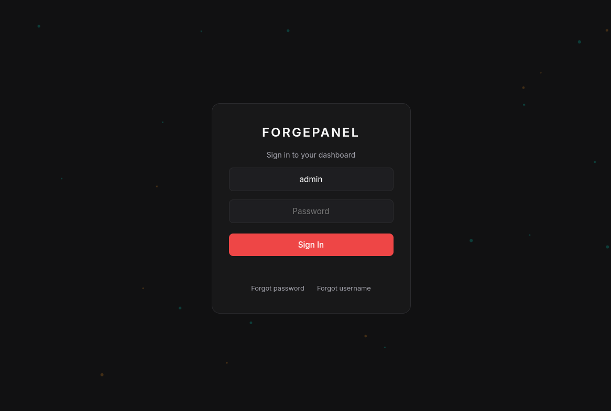
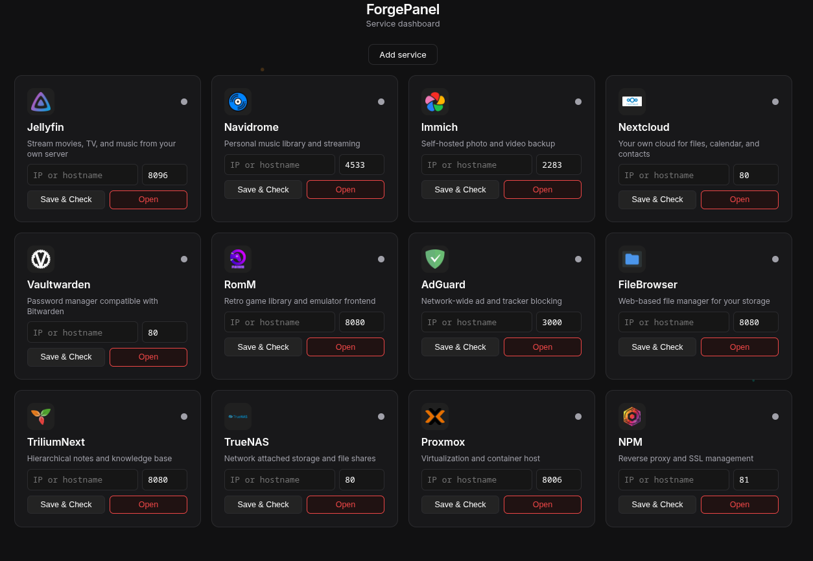
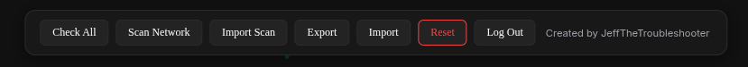
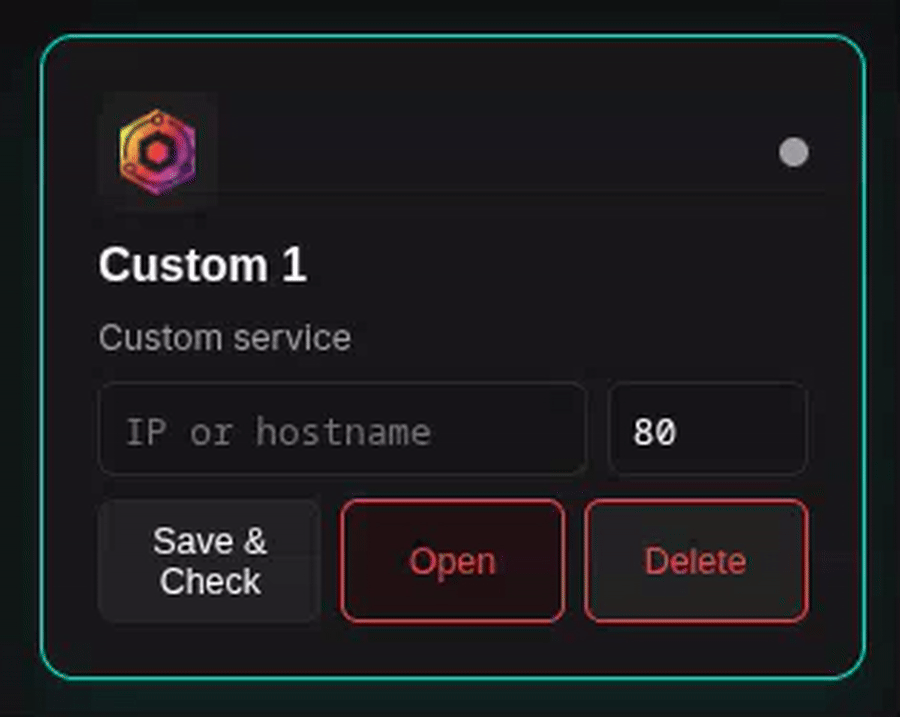

<p align="center"></p>

# ForgePanel-Dashboard

Self-hosted dashboard for accessing all your local and private services from one place. Add your own services, set names, IPs, ports, and icons, and check status at a glance.

## Core Map

Click the ForgePanel logo in the dashboard header to open **Core Map**, a full-screen animated view. The ForgePanel core sits in the center and every service (official and custom) is a tile on rings around it, joined to the core by a line:

- **Green**: connected/online. Data pulses travel along the line toward the core.
- **Red**: not connected/down. The line is dashed and flickers.
- **Yellow**: not detected (never checked, no address, or no status). The line is dashed and pulses slowly.

Hover a tile to see its name, URL and status. Click it to open the service. While Core Map is open it re-checks statuses through the server-side `/api/check` every 5 seconds. Press **Esc** or the ✕ button to close it. If your system asks for reduced motion, it draws a still map.

## Features

- Service cards with online/offline status
- Custom services (name, IP, port, icon)
- Python backend (`server.py`, standard library) with a SQLite database in `database/`
- Data encrypted at rest (AES-256-GCM, optional `cryptography` package)
- Export / Import / Reset
- Forgot password and username recovery
- Animated background
- Network scan that finds services and adds them automatically

## Screenshots

### Login


### Dashboard


### Settings toolbar
Check All, Export, Import, Reset and Log Out.




### Adding a custom service


[Full-quality MP4](screenshots/custom-service.mp4)

## Default Login

- **Username:** `admin`
- **Password:** `forgepanel`

Change credentials on first login.

## Structure

```
ForgePanel-Dashboard/
├── index.html
├── server.py            # static files + JSON API + SQLite
├── database/            # forgepanel.db lives here (gitignored, never served)
├── pages/
│   ├── login.html
│   ├── dashboard.html
│   └── dots.html
├── js/
│   └── auth.js
├── css/
│   └── main.css
├── assets/
│   └── icons/
├── config/
│   └── forgepanel.conf
├── custom_services/
└── scan/
    ├── scan.py
    ├── scan.conf
    └── results.example.json
```

## Network Scan

Click **Scan Network** in the dashboard toolbar. The server runs `scan/scan.py` (Python standard library), which TCP-scans your LAN for well-known self-hosted ports (Jellyfin, Immich, Nextcloud, Proxmox, Portainer, Home Assistant, Plex, Grafana and more, set in `scan/scan.conf`) and identifies services by HTTP title or Server header. Results are stored (encrypted) in the database; found official services fill their tiles, everything else is added as a custom service, and IP:port duplicates are skipped.

The CLI still works and writes `scan/results.enc` (encrypted with a password you type) for **Import Scan**:

```bash
python3 scan/scan.py
```

Details in [scan/README.md](scan/README.md).

## Auto-scans, Uptime, Groups and Server Stats

- **Scheduled auto-scans** – pick *Off / Hourly / Daily / Custom* in the toolbar (or set `[schedule] interval` and `minutes` in `scan/scan.conf`; the dashboard setting wins). Scans run in a background thread. Services you don't have a tile for show up under the **Scan history** button's badge, where you can accept (adds tiles) or dismiss (hidden for good). The last 50 scans are kept as history.
- **Uptime history** – the server checks every tile (default every 60 s, `--uptime-interval`) and stores up/down plus response time in SQLite for 8 days (`--uptime-retention`). Each tile shows a sparkline; click it for 24h / 7d graphs and the uptime %.
- **Groups and reordering** – *Add group* asks for a name and lets you tick which services go in it. Grab a tile by its ⋮⋮ handle (mouse or touch): it lifts with a yellow outline, the other tiles slide aside to open a gap where you point, and it drops exactly there. Drop it on another group (its header or its tiles) and you are asked to confirm the move; *No* puts it back. The tile's ⋮ menu also has *Move to group*. Groups can be renamed, deleted, collapsed and dragged to reorder. The layout is saved in the database.
- **Scan history** – the *Scan history* button (badge = new services waiting) lists recent scans and the new services to accept or dismiss.
- **Server stats** – the *Server stats* button shows CPU, RAM, disk, uptime, load and network (read from `/proc`), refreshed every 5 s with small graphs. Linux only.

Background jobs (auto-scans and uptime checks) need the data key, which only lives in memory. After the server starts they begin once someone signs in.

## HTTPS

Start with `--https` (or answer *yes* in the installer). On first start the server runs `openssl` to make a self-signed certificate in `database/certs/` (key is 0600, never served, never committed). Use `--cert` / `--key` to use your own certificate instead. The session cookie gets the `Secure` flag.

Your browser will warn because the certificate is self-signed. Either accept the warning once, or trust it: copy `database/certs/server.crt` to your computer and import it — Windows: *certmgr.msc → Trusted Root Certification Authorities*; macOS: Keychain Access → System → set *Always Trust*; Linux: copy to `/usr/local/share/ca-certificates/forgepanel.crt` and run `sudo update-ca-certificates`; Firefox: *Settings → Certificates → Authorities → Import*. If the server's IP or hostname changes, delete `database/certs/` and restart to make a new one.

## Database and Security

- `server.py` keeps everything in `database/forgepanel.db` (SQLite, file 0600, folder 0700). The server never serves `database/`, `scan/results.*`, `config/`, `.py`/`.sh`/`.conf` files or dotfiles, and has no directory listings.
- Passwords and security answers are hashed with scrypt and a random per-user salt. Sessions are random tokens in an `HttpOnly; SameSite=Strict` cookie that expires after 12 hours. Login, export and forgot-password attempts are limited to 5 failures per 5 minutes per IP.
- With the `cryptography` package (`python3-cryptography`) installed, dashboard settings, custom services and scan results are encrypted with AES-256-GCM. The data key is wrapped by keys derived from your password and your security answer, and is unwrapped only in server memory while you are signed in. Changing or resetting the password re-encrypts everything with a new key.
- **Without `cryptography` the data is stored unencrypted**; the server logs a warning at startup. Passwords are still hashed.
- The browser no longer stores anything except the session cookie, so the dashboard works over plain `http://<ip>`. Traffic itself is not encrypted on plain HTTP; put ForgePanel behind a reverse proxy with HTTPS (e.g. Nginx Proxy Manager) if you reach it over untrusted networks.

### Backup

Back up the `database/` folder (stop the service first), or use **Export** in the dashboard for a password-encrypted `forgepanel.conf`. See [database/README.md](database/README.md) for backup and restore steps.

### Upgrading from the IndexedDB version

Older versions kept data in the browser. Before upgrading, open the old dashboard and click **Export**; after upgrading, sign in (default `admin` / `forgepanel`, then set new credentials) and **Import** that file with the old password. Re-running the installer switches the service from `python3 -m http.server` to `server.py` automatically.

## Automatic Install (with service)

`forgepanel-install.sh` installs ForgePanel and sets it up as a service that starts on boot. It works on Debian/Ubuntu, Fedora/RHEL, Arch, openSUSE and Alpine. It installs python3 (with sqlite3), git, curl and python3-cryptography and openssl, checks that `import sqlite3` / `import cryptography` work, clones or updates the repo (default `/opt/forgepanel`), creates `database/` (0700), asks which port to use (default `8084`) and whether to enable HTTPS (adds `--https`), opens that port in ufw/firewalld if active, and creates a `forgepanel` systemd service (OpenRC on Alpine) running `python3 server.py --port <port> --host 0.0.0.0`. Running it again on an existing install pulls the latest code and restarts the service.

```bash
curl -fsSL https://raw.githubusercontent.com/JeffTheTroubleshooter/ForgePanel-Dashboard/main/forgepanel-install.sh -o forgepanel-install.sh
bash forgepanel-install.sh
```

Then open `http://<your-server-ip>:8084`. To manage the service:

```bash
sudo systemctl status forgepanel
sudo systemctl restart forgepanel
sudo systemctl disable --now forgepanel   # stop and remove from boot
```

## Uninstall

Run the same script with `uninstall`:

```bash
bash forgepanel-install.sh uninstall
```

It stops and removes the `forgepanel` service (systemd, or OpenRC on Alpine), asks whether to delete the database (`database/`), asks which install directory to delete (default `/opt/forgepanel`; if you keep the database it is first copied to `~/forgepanel-database-backup-<date>`), and then asks whether to remove python3 and git too. Say no to that last question if other software on the machine uses them.

## Manual Run

```bash
cd ForgePanel-Dashboard
python3 server.py                 # http://localhost:8084, database in database/
python3 server.py --port 8084 --host 0.0.0.0 --db database/forgepanel.db
# optional: --https [--cert FILE --key FILE] --uptime-interval 60 --uptime-retention 8
```

Then open `http://localhost:8084` (or `http://<server-ip>:8084`). A plain static server (`python3 -m http.server`) no longer works, because the dashboard needs the API.

## License

MIT. See [LICENSE](LICENSE).

Service logos in `assets/icons/` are trademarks of their respective projects and are not covered by the MIT license.
